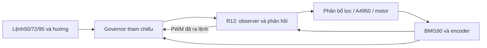

# RT12 GOV95 — chạy và cân bằng có xét giới hạn motor

Ngày31/10/2026. Nền làR12 phản hồi trạng thái/observer/phân bổ lực, không phải PIDcascade cũ. Bản này giữ50/72/MAX95, đổi cách sinh tham chiếu và xử lý lỗi. Chưa có thử xe thật choRT12; không gọi95 là đã được chứng minh ổn định hay bảo đảm vận hành lâu dài.

## 1. Bằng chứng từ log31/32/33

| File | Mẫu | CRC/gaps/overflow/resetSTM32 | Quan sát chính |
|---|---:|---|---|
|31|6557|0/0/0/0|Hai lần ngã ởMAX; nhiều lầnREC khi72|
|32|5952|0/0/0/0|72 liên tục chạy–REC–gần đứng yên–chạy lại; cuối cóSTOP|
|33|1097|0/0/0/0|MAX ngã; trước đó có một lầnREC khi chuyển động/braking|

Đã tìm38lần vàoREC ở preset72 trong31/32. Ở các mẫu đầuREC, góc thường chỉ khoảng1–2°, tốc độ thực khoảng0,78m/s trong khi tham chiếu quanh0,71–0,72. `BalanceRecovery_Reserve` cũ coi vượt0,78 và chênh hơn0,04m/s là cầnREC kể cả thân xe còn ổn. REC làm `allow=false`, kéo tham chiếu về0, đợi yên rồi nhận lại lệnh vẫn đang giữ: khớp chính xác cảm giác dừng–chạy.

Tái hiện riêng38ảnh chụp50Hz:33ảnh đủ kích hoạt lại predictor cũ; predictor có điều kiện thân xe mới không kích hoạt ở38ảnh. Năm ảnh còn lại không tái hiện đúng sự kiện bằng một mẫu50Hz; không thể suy ra đầy đủ mẫu200Hz bị lược. Đây là replay thành phần, không phải mô phỏng lại toàn bộ xe chỉ từ log.

Ba lần mất cân bằngMAX:

| tSTM32 trước ngã | v thực | vref | pitch/gyro | PWM |
|---:|---:|---:|---:|---|
|116309ms|0,9247|0,9320|20,79°/166,41°/s|2499/2499|
|228169ms|−0,9530|−0,9455|−18,21°/−169,02°/s|−2499/−2499|
|476709ms|0,9078|0,9365|17,86°/152,08°/s|2499/2499|

Sau100–120ms, góc đã khoảng48–52° và xuất hiện fault8192. VìPWM đã bão hòa và góc tăng trước fault, không quy nguyên nhân ngã chỉ cho việc bảo vệ cắt motor. Xe thiếu khả năng chỉnh thêm lực ở vùng tốc độ đó. Việc RT11 nâng dốc lên0,60/0,30 giúp nhanh nhưng chưa quản lý đủ tính khả thi của tham chiếu; không thể giải quyết bằng chỉ nâng trần bảo vệ.

## 2. Đánh giá thiết kế và tài liệu đối chiếu

R12 có nền phản hồi/ước lượng và ưu tiên lực cân bằng hợp lý. Điểm yếu là lớp sinh vận tốc chưa xét dự phòng actuator đủ sớm, trong khi một predictor lại coi overshoot bình thường là sự cố. Không đổi toàn bộ luật đang cân bằng tốt ở50 để giải quyết hai lỗi ở lớp trên.

| Hướng thiết kế | Điều học được | Quyết định hiện tại |
|---|---|---|
|GiữR12 + reference/command governor|Điều chỉnh tham chiếu khi ràng buộc sắp chạm thay vì yêu cầu bộ điều khiển làm việc bất khả thi|Chọn kiến trúc này; triển khai bộ giám sát thực dụng dựa PWM/IMU/encoder|
|Tối ưu quỹ đạo có ràng buộc +LQ/MPC|Kế hoạch chuyển động phải tính giới hạn trạng thái/mômen, tách khỏi vòng phản hồi cân bằng|Chưa thay bằngMPC; cần mô hình motor có tải được nhận dạng và benchmark thời gian trước|
|Velocity smoothing có feedback|Giới hạn gia tốc/giảm tốc và dùng phản hồi vận tốc để tránh lệnh giật|Dùng nguyên tắc làm mượt; không lấy bộ làm mượt robot thường làm bằng chứng tự cân bằng|

Nguồn chính: [Garone/DiCairano/Kolmanovsky, khảo sát reference/command governors](https://merl.com/publications/docs/TR2016-102.pdf) mô tả lớp bổ sung quản lý ràng buộc trên hệ đã ổn định; [nghiên cứu WIP tối ưu quỹ đạo có ràng buộc kết hợp phản hồiLQ](https://arxiv.org/abs/1811.12819) cho thấy vai trò của việc thiết kế quỹ đạo cùng giới hạn; [Nav2 Velocity Smoother](https://docs.nav2.org/rolling/configuration_and_development/configuration_guide/core_servers/configuring_velocity_smoother/) mô tả smoothing theo giới hạn và feedback; [NIST về giảm overshoot bằng reference governor](https://www.nist.gov/publications/overshoot-mitigation-using-reference-governor-framework) là đối chiếu thêm cho vấn đề vượt mục tiêu.

**Không nhận đây là một reference governor hình thức có chứng minh invariant-set, MPC hay AI học máy.** Mã mới là reference shaper phản hồi có ngưỡng thực dụng, phải kiểm chứng tiếp trên xe. Các bài báo không chứng minh riêng các ngưỡng chọn cho xe888g này.

## 3. Thay đổi thực tế

- Giữ tốc độ yêu cầu95. Bổ sung `balance_governor.h`, chạy200Hz trước tích phânxref. Giới hạn biến thiên gia tốc, theo dõi lệnhPWM đã dùng, pitch/gyro dự báo ngắn và chênh vận tốc tham chiếu–encoder.
- Ở50, trần gia tốc danh định0,60 được giữ nhưng lên gia tốc mềm. Khi yêu cầu72/95: trần tăng tốc0,35m/s² dưới0,5m/s,0,18 phía trên; giới hạn jerk2m/s³. Hãm/đảo hướng tối đa0,65m/s² với jerk2,5. Capture điểm đặt cuối vàSTOPcứng là ngoại lệ của tính liên tục gia tốc; không tuyên bố ràng buộcjerk hình thức trong mọi sự kiện.
- PWMcommand được lọc với hệ số0,125; vượt90%, pitch dự báo theo hướng đi>5°, hoặc tham chiếu vượt tốc độ thực hơn0,12m/s thì ngừng tăng thêm tham chiếu. Vẫn giữ lệnh/ready và tốc độ đang có, không chuyển thành một chu kỳ đứng yên. Có hysteresis300ms khi dự phòng trở về.
- NếuPWM≥98,5% liên tục40ms hoặc dự báo nghiêng>8°, giảm nhẹ tham chiếu khoảng0,10m/s² để lấy lại dự phòng, thay vì tiếp tục ép95 cho tới ngã. PWM là chỉ báo dự phòng điều khiển, không phải cảm biến đo mômen/dòng hay công suất thực.
- Khi bị giới hạn, giới hạn phầnxref đi trước thân xe còn10cm; không sửa encoder hoặc x_actual. Ngưỡng này vẫn lớn hơn6cm của kiểm tra bánh kẹt, để không che trường hợp xe bị giữ/đụng tường. Ngắt khi kẹt và envelope hãm1m/4giây vẫn còn.
- Predictor overspeed chỉ được gọi thêm khi thân xe có dấu hiệu đáng lo: |pitch|>5° hoặc |gyro|>60°/s. Các trigger mất ổn định thực sự trongREC, góc, tốc độ cứng, lỗiIMU/timing/va chạm và lease350ms vẫn còn.
- Không đổi gains/matrix/observer/hiệu chuẩn motor R12; không đổi khối lượng/cơ khí mô hình để làm kết quả đẹp. Motionstruct và frame122byte/CSV40cột giữ nguyên. `motion_flags16384` mới báo tham chiếu đang bị giới hạn; web hiển thị tốc độ khả dụng, khác với preset đã chọn.

**Giữ lựa chọn95 không có nghĩa luôn ép tốc độ thực95.** Nếu motor thiếu lực khi mang888g ở điện áp hiện tại, phần mềm không thể đồng thời bảo đảm95 và khả năng giữ cân bằng. Mã mới cố giữ mức cao nhất đang khả thi liên tục và thử tăng lại khi có dự phòng; không âm thầm đổi presetMAX thành80. Dự phòng10% là ngưỡng khởi đầu cần đối chiếu log mới, không phải giới hạn vật lý đã được đo chính xác.

## 4. Vận hành lâu dài và BMI160

Sau một lần đọcBMI lỗi, latch lỗi và dừng motor; các tick ngắt sau không gọi lại giao dịchI2C đang lỗi. Nhờ đó không lặp HALBUSY/timeout trong ngắt200Hz làm đói luồng chính/UART. Frame lỗi vẫn được phục vụ, giúp web nhận được trạng tháiSTM32 thay vì buộc rút pin chỉ để giao diện hoạt động lại.

Khi người dùng bấm ĐO LẠI GYRO trong trạng thái dừng, pauseTIM4 và thử `BMI160_Init` ngoài ngắt trước khi hiệu chuẩn. Nếu vẫn lỗi thì tiếp tục báo lỗi và giữ motor dừng. Thành công vẫn cần một lầnARM mới; không tự chạy lại. Đã kiểm đường lỗi/khôi phục bằng mock đọc cảm biến, chưa fault-injection trên phần cứng. Không sửa được dây breadboard lỏng, sụt nguồn, nhiễu, hỏng cảm biến hoặc mọi dạng kẹt bus chỉ bằng phần mềm.

Không có đo dòng/nhiệt/điện áp pin trực tiếp, nên chưa thể chứng nhận chạy lâu không nóng/sụt nguồn. `archive_error=1` ở log cũ cũng chưa được sửa/formatFFat trong lượt này. RAMlog10phút và ghi lỗi sống được giữ.

## 5. Kiểm chứng

- 7 bộ: `test_balance_governor`, `test_rt12_replay72`, `test_production_controller`, `test_production_dashboard`, `test_production_session`, `test_production_gateway`, `test_balance_recovery` trongtools. Đã qua jerk/ramp,95 có thể đạt khi giả lập đủ lực, giữ tham chiếu dài, đảo chiều, hold/resume theoPWM, ưu tiên nhả, kẹt bánh không bị che,NaN, owner/sequence/STOP/HTTP, lỗiBMI một lần rồi không đọc lại trongIRQ và yêu cầuCALIB/ARM mới.
- Header luật/paramsR12 vẫn khớp bản mô phỏng, headerUART haiMCU giống nhau. Mô phỏng chẩn đoán bổ sung6ca20giây:50/72/95 tiến,95 lùi, đảo hướng, quẹo ở11,2V. Tất cả chạy hết, khôngREC/fault trongtrace, tham chiếu cuối0. Kết quả `Simulation/results/runs/20261031_210243_076_motor_catalog_rt12_governor`; tái tạo bằng `node tools/run_governor_sim.cjs`.
- Trong mô hình,50/72 giữ khoảng0,499/0,719m/s; MAX thẳng được governor giữ khoảng0,83–0,84 thay vì cố95 rồi ngã. Đây là minh họa đúng chức năng tự giới hạn, không phải tiên đoán chính xác tốc độ xe thật. Torque/contact/ma sát có tải chưa nhận dạng đầy đủ. Adapter không mô phỏngWi-Fi hoặc lỗiI2C và không thay thế toàn bộFSM trênboard. Tốc độ dư cuối20giây của ca quẹo còn khoảng1,1cm/s; không gọi đó là đứng yên tuyệt đối.

## 6. Bản nạp

STM32 `BAL-20261031-R12-8DIR-RT12-GOV95`; ESP32 `TWIP-WEB-20261031-BAL-R12-8DIR-RT12-GOV95-NET9`. Nạp đồng bộ từ `.build/balance_release_r12_rt12_gov95_20261031/`; mở `http://192.168.4.1/ui/r12?v=rt12-gov95-net9`. BảnRT11/RT10 dự phòng không bị ghi đè. Chưa nạp hoặc thửRT12 trên xe, chưapush.

Nên lấy riêng log giữ72 liên tục và logMAX trên đường đủ khoảng hãm, rồi log đổi hướng; tải sauSTOP/chờ2giây và xóa trước lượt kế tiếp để tách bằng chứng. Quan sát cả tốc độ đã chọn, vref thực sự và bit16384; không lấy riêng tốc độ preset làm kết quả đo. Mục tiêu cần xác nhận là giảmREC không cần thiết và tránh bão hòa kéo dài, không chỉ một mẫu tốc độ đỉnh cao.

Build cuối cả hai MCU thành công: STM32:text75984/data492/bss7460byte; ESP32:1074847byte flash(34%),54004byte RAMtĩnh(16%). Đã kiểm buildID trực tiếp trong haiBIN và trạng tháigovernor/chu kỳweb20–100ms trongBINESP; dấu nguồn và SHA-256 trong `manifest.json`. Không dùng binary ở thư mục `ESP32_S3_Gateway/build` cũ. Hook sao chép mặc định bị lỗi khóaELF được bỏ cho lầnbuildCLI này, xuất vào thư mục riêng đã kiểm; không sửaSDK toàn máy.
